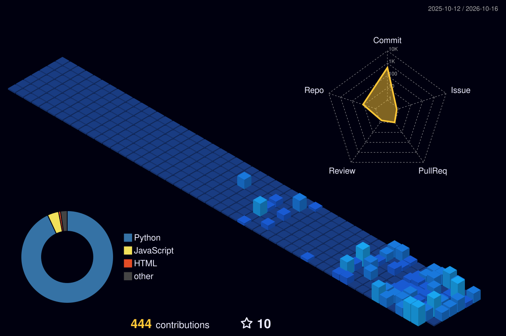

<h1 align="center">Hi, I'm Palak</h1>
<h3 align="center">CSE (AI/ML) student · Building AI systems that solve real problems</h3>

  

---

### About me

B.Tech Computer Science and Engineering (AI/ML) student who likes building things, from computer vision dashboards to RAG agents to explainable AI systems, rather than stopping at a notebook.

**Research and internships**

- **Research and Development Intern, Robotics Lab, Woxsen University (Feb 2026 – Present):** Part of an IIT Mandi iHub and HCI Foundation (NM-ICPS funded) project on HCI-driven smart mobility. I led integration of the full hardware stack (Raspberry Pi 5, Intel RealSense T265, IMU, GPS) on a bicycle prototype and built a real-time computer vision gradient-detection pipeline (Canny edge detection, Hough Transform, EMA smoothing) with about ±2° pitch accuracy.
- **Research Intern, BITS Pilani, Hyderabad Campus (Nov 2025 – Jan 2026):** Worked on "Virtual Inertia Monitoring and Self-Healing Mechanisms in Smart Grids using Data Analytics and Machine Learning." Modeled IEEE 39-Bus, MVMicrogrid and Wind Farm networks in DigSILENT PowerFactory, ran fault simulations with CCT estimation, and used Park's DQ transformation for feature engineering. SVM, Random Forest, XGBoost and GRU models reached 82–92% fault-classification accuracy across grid topologies.

**Interests:** Machine Learning · Deep Learning · Computer Vision · Reinforcement Learning · RAG and AI Agents · Explainable AI (XAI) · Multi-Agent Systems

**Open to:** internships and collaborations in ML, smart systems, and data-driven engineering. Feel free to connect.

---

### Projects

| Project | What it does | Stack |
|---|---|---|
| **[Devora](https://github.com/pdpalak17/devora)** | One-line description of what Devora does and the problem it solves | Add your stack here |
| **[Diabetic Retinopathy Decision Support](https://github.com/pdpalak17)** | End-to-end multimodal clinical decision-support system for DR screening; fuses deep transfer learning (computer vision), ML and RAG to give ophthalmologists grounded, evidence-based explanations | Transfer Learning, RAG, Streamlit |
| **[CycloVision-AI](https://github.com/pdpalak17/CycloVision-AI)** | Intelligent e-bike HUD with real-time object detection, OpenCV gradient/pitch analysis, GPS field-ride logging, battery telemetry, fall/SOS detection | TensorFlow.js, OpenCV, Leaflet.js, Python |
| **[Bicycle-Gradient-Tracker](https://github.com/pdpalak17/Bicycle-Gradient-Tracker)** | Computer-vision bicycle gradient and pedal-force tracker using Intel RealSense | Python, OpenCV |
| **[SENTINEL-AI](https://github.com/pdpalak17/Reliability-Aware-Multimodal-Anomaly-Detection)** | Reliability-aware multimodal anomaly detection: fuses facial, pose, motion and context signals with confidence-weighted fusion and SHAP-based explanations | PyTorch-style CNN-LSTM branches, OpenCV, MediaPipe, Streamlit, Docker |
| **[Vynce](https://github.com/pdpalak17/vynce)** | Full-stack synchronized music listening platform with an 8M+ song catalog, custom MLP recommendation engine and real-time sync | FastAPI, SQLAlchemy, WebSockets, JWT/bcrypt, Docker, Hugging Face Spaces |
| **[OculiRAG](https://github.com/pdpalak17/glaucoma-rag-agent)** | Agentic RAG clinical decision-support tool: retrieves clinical guidelines and reasons through a multi-agent pipeline to recommend target IOP for glaucoma | FastAPI, scikit-learn (TF-IDF), Docker |
| **[Battery Health XAI](https://github.com/pdpalak17/battery-health-lime-explainable-ai)** | Explainable battery health monitoring on NASA battery datasets: predictive maintenance with LIME-based feature attributions | Random Forest, XGBoost, LIME |

*Also maintaining a private [LeetCode solutions](https://github.com/pdpalak17/LeetCode-Solutions) repo for interview prep.*

---

### Tech Stack

**Languages**

**ML / AI Libraries**

**Algorithms and Techniques**

**Backend, Databases and Cloud**

**Tools and Platforms**

---

<!-- 3D contribution graph: generated daily by .github/workflows/profile-3d.yml -->

  

### Connect

  
  
  
  

